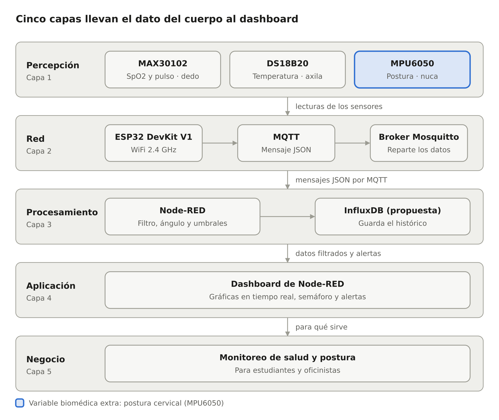
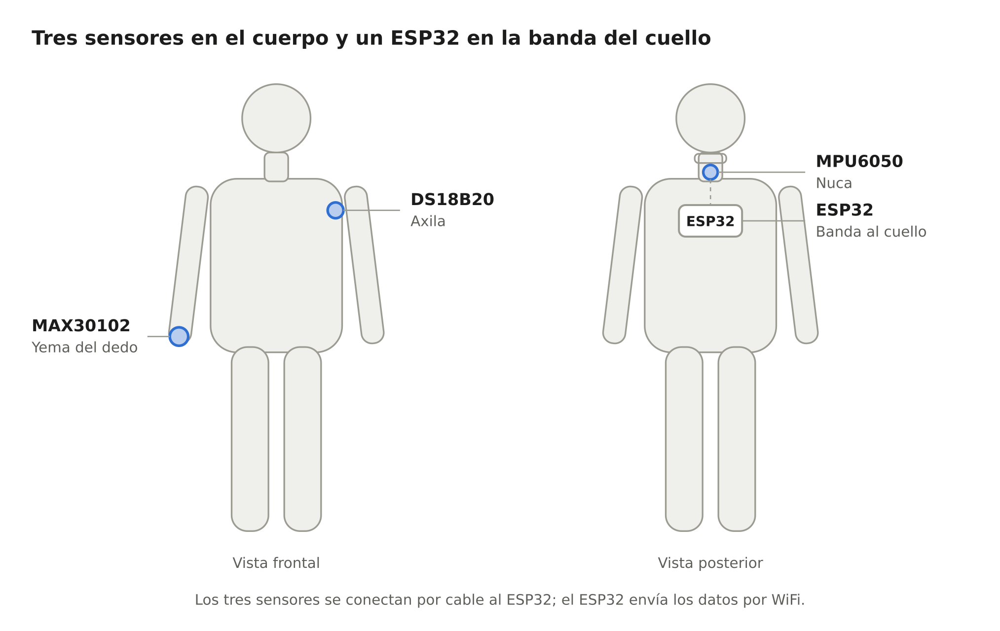

# PostuVital

Proyecto de dispositivo vestible para medir **saturación de oxígeno (SpO2)**, **frecuencia cardiaca**, **temperatura corporal** y **postura cervical**, con la meta de mostrar los datos en tiempo real en un dashboard con alertas.

**Materia:** Implementación de internet de las cosas (Gpo 501)

## Equipo 1 · Pulso Binario

| Integrante | Matrícula | Rol | Capas |
|---|---|---|---|
| Rodrigo Herrera Ávila | A01803050 | Hardware y conectividad del lado del ESP32: circuito, lectura de sensores y envío por MQTT | 1 y 2 |
| Alejandro Lazo de la Vega Martínez | A01804700 | Conectividad del lado del servidor, datos y visualización: broker, Node-RED, base de datos y dashboard | 2, 3 y 4 |

## Qué mide y para qué sirve

La arquitectura propuesta coloca tres sensores en el dedo, la axila y la nuca. Un ESP32 en una banda al cuello leerá sus datos y los enviará por WiFi con MQTT a Node-RED para procesarlos, almacenarlos y visualizarlos. Esta integración completa sigue en desarrollo.

La variable biomédica extra, elegida en la semana 1, es la **postura cervical**: avisa cuando la cabeza se mantiene inclinada por mucho tiempo, un problema común en quienes pasan horas con el celular o la laptop.

Está pensado para **estudiantes y oficinistas** que quieren monitorear su salud y su postura para prevenir problemas de cuello.

| Variable | Visualización | Alerta de ejemplo |
|---|---|---|
| SpO2 | Gráfica en vivo y semáforo | Menor a 92 % |
| Frecuencia cardiaca | Gráfica en vivo y semáforo | Fuera de 50 a 120 lpm |
| Temperatura | Gráfica en vivo y semáforo | 37.5 °C o más |
| Postura cervical | Ángulo en vivo y semáforo | Más de 20° durante varios minutos |

*Los umbrales son ejemplos y se ajustan durante las pruebas.*

## Arquitectura (v1)



Los datos bajan por cinco capas: los sensores los miden, el ESP32 los envía por MQTT, Node-RED los procesa y guarda, el dashboard los muestra y la capa de negocio define para quién sirven.

## Tecnología por capa

| Capa | Componente | Tecnología | Por qué |
|---|---|---|---|
| 1. Percepción | Sensor de SpO2 y pulso | MAX30102 | Un solo módulo mide las dos variables |
| 1. Percepción | Sensor de temperatura | DS18B20 sumergible | Barato, con cable y librerías sencillas |
| 1. Percepción | Sensor de postura (variable extra) | MPU6050 | Acelerómetro y giroscopio para calcular la inclinación del cuello |
| 2. Red | Microcontrolador | ESP32 DevKit V1 | WiFi integrado, 3.3 V y se programa en Arduino IDE |
| 2. Red | Protocolo | MQTT sobre WiFi 2.4 GHz | Estándar de IoT, ligero y con mensajes JSON |
| 2. Red | Broker | Mosquitto | Gratuito y compatible con Node-RED |
| 3. Procesamiento | Lógica de datos | Node-RED | Programación por bloques: promedio móvil, ángulo del cuello y umbrales |
| 3. Procesamiento | Base de datos | InfluxDB (propuesta) | Pensada para series de tiempo y con nodo para Node-RED |
| 4. Aplicación | Dashboard | Dashboard de Node-RED | Gráficas en tiempo real, semáforo y alertas, desde el navegador |
| 5. Negocio | Usuarios y propósito | Estudiantes y oficinistas | Monitoreo de salud y postura para prevenir problemas de cuello |

## Ubicación en el cuerpo



El MAX30102 va en la yema del dedo, el DS18B20 en la axila y el MPU6050 en la nuca; el ESP32 va en una banda al cuello. Es un esquema: la ubicación final se ajusta al armar el prototipo.

## Avances

- [x] **Ficha de equipo:** equipo Pulso Binario, proyecto PostuVital, variables SpO2, frecuencia cardiaca y temperatura corporal.
- [x] **Variable extra elegida (semana 1):** postura cervical con un MPU6050 en la nuca.
- [x] **Arquitectura v1:** diagrama en cinco capas y tecnología por capa ([documento de la Etapa 1](docs/PostuVital_Arquitectura_v1.docx), entregado el 06/10/2026).
- [x] **Etapa 2, pruebas individuales:** lecturas IR/Red del MAX30102 y temperatura del DS18B20 por monitor serial.
- [x] **Etapa 2, conectividad:** prueba de WiFi, IP asignada y respuesta HTTP 200.
- [x] **Etapa 2, documentación:** [reporte y evidencias](docs/etapa2/README.md).
- [ ] **Pruebas de integración:** comprobar ambos sensores al mismo tiempo en el mismo montaje.
- [ ] **Etapas posteriores:** obtener frecuencia cardiaca y SpO2 a partir de las señales ópticas; integrar MPU6050, MQTT, Node-RED y dashboard.

**Componentes y pruebas realizadas:**

| Componente | Estado |
|---|---|
| ESP32 DevKit V1 | Probado por serial y WiFi |
| MAX30102 | Probado por separado (IR/Red) |
| DS18B20 sumergible | Probado por separado (temperatura) |
| MPU6050 | Planeado; sin evidencia de prueba en esta etapa |

## Etapa 2: montaje y primeras lecturas

- [Reporte de cierre de la etapa 2](docs/etapa2/Cierre_Etapa_2.pdf) (copia preparada para el repositorio, con credenciales ocultas).
- [Diagrama de conexiones y fotografías](docs/etapa2/README.md).
- [Código fuente del ESP32](firmware/README.md): prueba individual del MAX30102, prueba del DS18B20, prueba WiFi y un sketch para lectura conjunta todavía no validado físicamente.

Las lecturas IR/Red son valores ópticos **sin convertir** a pulsaciones por minuto ni a SpO2. La prueba HTTP confirma conectividad, no el envío de datos biométricos. No se deben interpretar los valores como mediciones clínicas.

## Estructura del repositorio

```
PostuVital/
├── docs/        Arquitectura de Etapa 1 y reporte/evidencias de Etapa 2
├── firmware/    Sketches del ESP32 (Arduino IDE)
└── nodered/     Flujos de Node-RED (pendientes)
```
